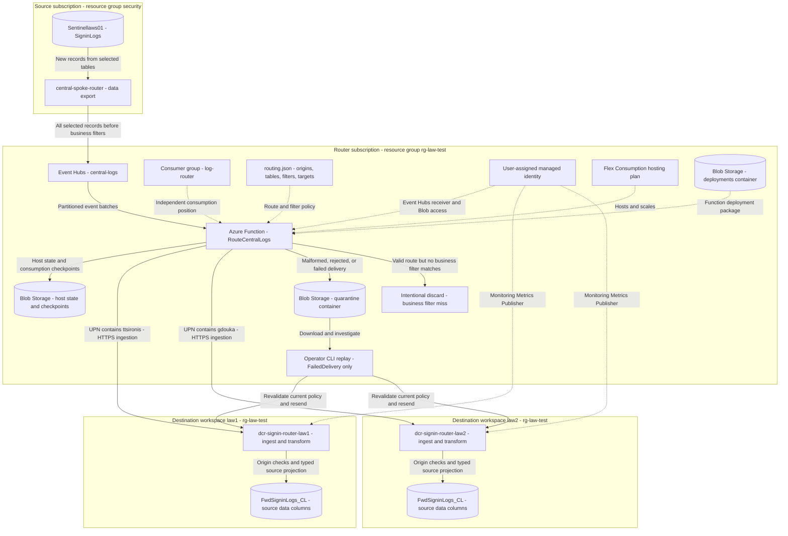
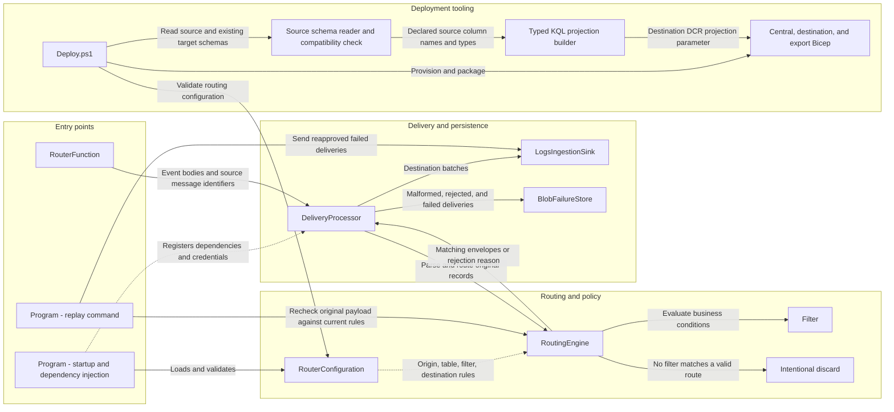

# Architecture Diagram

The router exports newly arriving logs from one central Log Analytics workspace, applies configured origin and record filters, and forwards matching records to destination workspaces. This view is grounded in the infrastructure templates and current configuration, not a live Azure deployment-health check; the last reported source-export deployment failed for missing permissions.

## Application Architecture

Solid arrows show log and persistence flows; dotted arrows show configuration, identity, or hosting relationships.

<!-- mermaid-checked: no \n, no em-dash/en-dash, no {} in labels, subgraphs are id["label"], arrows are -->|"label"|, all subgraphs closed by end, ids unique -->

### Technology Stack Summary

| Layer | Technology | Version | Purpose |
|---|---|---|---|
| Source and destination | Azure Monitor Log Analytics | Managed service | Central log source and queryable destination tables |
| Export | Log Analytics data export | ARM API 2023-09-01 | Continuously exports new records from the union of configured source tables |
| Transport | Azure Event Hubs Standard | Managed service | Buffers partitioned events; managed hub uses 32 partitions and seven-day retention |
| Processing | Azure Functions isolated worker and C# | Functions v4, .NET 10 | Validates records, resolves origin, applies filters, batches, and fans out deliveries |
| Hosting | Azure Functions Flex Consumption | FC1 | Hosts the Function and provides event-driven scale |
| Ingestion | Logs Ingestion API and Direct DCRs | API 2023-01-01; DCR ARM 2023-03-11 | Accepts authenticated batches, enforces origin boundaries, and projects typed source fields |
| Persistence | Azure Blob Storage | StorageV2, Standard LRS | Host checkpoints, deployment packages, and durable quarantine |
| Identity | Microsoft Entra managed identity | User-assigned | Authenticates Function access to Event Hubs, Blob Storage, and destination DCRs |
| Deployment | PowerShell, Azure CLI, Bicep | PowerShell 7; .NET 10 SDK | Reads source schemas, provisions resources, packages configuration, and deploys the Function |

### Data Storage & External Services

- **Source placement:** `Sentinellaws01` is in resource group `security`, subscription `09677c47-33bc-4220-953d-207ebb36097e`.
- **Router and destination placement:** the supplied deployment commands place router infrastructure in `rg-law-test`, subscription `48f1a68c-cd48-430c-af15-b176f81fc22d`. Both `law1` and `law2` are in this resource group.
- **Event Hubs namespace:** `ehlr-law-test-b0525cd5` is reused. Namespace capacity/settings are not managed on reuse; the configured hub and consumer group are managed.
- **Destination ingestion:** each workspace has its own Direct DCR and HTTPS Logs Ingestion API endpoint. There is no separate data collection endpoint resource in these templates.
- **Storage:** one router storage account supports host state/checkpoint blobs, the `deployments` container, and the `quarantine` container. Quarantine stores failure envelopes rather than acting as an automatic Event Hubs dead-letter queue.
- **Synthetic alternative:** [routing.synthetic-test.json](../../../../../src/LogRouter/routing.synthetic-test.json) uses source workspace `sentinellaws01-test-b0525cd5`, source table `SyntheticSigninLogs_CL`, destination table `FwdSyntheticSigninLogs_CL`, and DCRs `dcr-synthetic-router-law1` and `dcr-synthetic-router-law2`. It replaces the production source/configuration for a run; it is not an additional source consumed simultaneously by one configured router.

### Key Architectural Decisions

1. **Central filtering with defense in depth:** data export sends all newly arriving records for selected tables; the Function applies origin/table selection and business filters. Each DCR independently checks source-workspace, source-table, and allowed origin metadata before projection. Both current routes use the same configured tenant origin and case-insensitive `UserPrincipalName` substring filters.
2. **Source-shaped destination data:** the transport envelope contains routing metadata and the original `Payload`; DCRs project only source data fields into the destination, using typed conversions including `toguid`. Azure-managed metadata remains service-controlled. Deployment creates missing tables from source definitions but never updates existing tables; incompatible existing schemas stop deployment.
3. **At-least-once delivery with explicit recovery:** transient ingestion failures receive up to four HTTP attempts. Permanent/exhausted delivery failures, malformed messages, and rejected records are quarantined. Business-filter misses are intentionally discarded. Unhandled failures, including failure-store persistence errors, fail the invocation and trigger retry before checkpoint progress; duplicates are possible. Only failed-delivery envelopes support automated CLI replay, with current policies revalidated.

Deployment reads source and existing destination schemas, provisions router resources with the trigger disabled, provisions missing tables and DCRs, deploys the application and resolved configuration, enables the trigger, and finally creates or updates the source export rule. The export rule requires permissions in the source resource group, even when router resources are in another subscription. A failed export deployment can leave the other components provisioned without a working source feed.

## Component Relationships

These are logical components inside the Function executable and its deployment tooling, not separately deployed services.

<!-- mermaid-checked: no \n, no em-dash/en-dash, no {} in labels, subgraphs are id["label"], arrows are -->|"label"|, all subgraphs closed by end, ids unique -->

### Component Inventory

| Component | Layer | Type | Responsibility |
|---|---|---|---|
| RouterFunction | Entry | Event Hubs trigger | Receives batches, normalizes event metadata, and delegates processing; configures unlimited invocation retry with exponential backoff |
| Program startup | Entry | Host bootstrap | Loads configuration, checks hub settings, registers dependencies, and configures credentials and HTTP clients |
| RouterConfiguration | Policy | Validated configuration model | Defines source, routes, origins, table mappings, stream names, and filters; rejects invalid or conflicting mappings |
| RoutingEngine | Policy | Routing service | Parses supported JSON shapes, validates table/timestamp/origin, evaluates routes, and builds transport envelopes |
| Filter | Policy | JSON predicate evaluator | Evaluates configured field comparisons and nested Boolean conditions |
| DeliveryProcessor | Delivery | Batch orchestrator | Groups deliveries by route/stream, caps request size, limits concurrent groups, and persists handled failures |
| LogsIngestionSink | Delivery | HTTPS adapter | Gets an Entra token and submits batches to the selected DCR immutable ID and stream; retries transient failures |
| BlobFailureStore | Persistence | Blob adapter | Persists deterministic failure envelopes without overwriting identical existing blobs |
| Program replay | Recovery | CLI command | Loads a downloaded FailedDelivery envelope, revalidates current routing policy, and resends approved records |
| Deploy.ps1 | Deployment | PowerShell orchestrator | Validates placement/access, packages the Function, resolves DCR endpoints, and deploys infrastructure and source export |
| Source schema reader | Deployment | PowerShell functions | Reads declared source columns and compares existing target schemas without updating existing tables |
| Typed projection builder | Deployment | PowerShell function | Builds DCR expressions that unwrap Payload into source-shaped, correctly typed columns |
| Bicep templates | Deployment | Infrastructure as code | Define hosting, Event Hubs, identity, Blob Storage, conditional table creation, DCRs, role assignments, and export |
